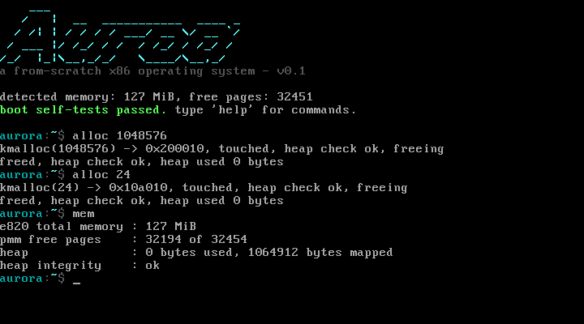

# Aurora

A 32-bit x86 operating system written from scratch: two-stage bootloader,
protected mode, identity paging, physical and virtual memory management,
interrupt-driven drivers, and an interactive shell. No GRUB, no standard
library, no starter code - every byte on the boot disk comes from this tree.



## What it does

- Boots from a raw disk image on any PC BIOS or QEMU: the BIOS loads a 512-byte
  boot sector, which pulls the stage-2 loader and the kernel off disk with
  EDD packet reads, enables A20, records the E820 memory map, installs a flat
  GDT, enters protected mode, copies the kernel to 1 MiB, and turns on
  identity paging (4 MiB pages, low 128 MiB).
- Kernel takes over: zeroes .bss, installs its own GDT and a full 256-entry
  IDT, remaps the PIC, and starts the timer (100 Hz) and keyboard IRQs.
- Memory: E820-driven bitmap physical page allocator (4 KiB frames,
  contiguous runs supported) with a best-fit free-list kernel heap on top.
- Shell: `help`, `about`, `mem`, `alloc N`, `uptime`, `echo`, `history`,
  `color`, `clear`, `halt`.
- Everything the kernel prints also goes to the COM1 serial port, which is
  what the automated boot test asserts on.

## Build

Requires `nasm`, `gcc` (with `-m32` support), `ld`, `objcopy`, `make`.
Debian/Ubuntu: `sudo apt install nasm gcc make binutils`.

```sh
make            # produces build/aurora.img
```

## Run

```sh
./scripts/run.sh        # boots build/aurora.img in QEMU
```

Type `help` at the `aurora:~$` prompt. `alloc 1048576` allocates a megabyte
from the heap and touches every page of it; `mem` shows the E820 totals,
free pages and heap state; `halt` stops the CPU.

## Test

```sh
./tests/host/run_tests.sh    # 198 unit checks: string, PMM, heap, printf
./tests/run-qemu-tests.sh    # boots the real image, asserts serial markers
```

The host suite compiles the kernel's portable sources (string library,
physical allocator, heap, formatted printing) against a fake E820 map and
runs them natively. The QEMU test boots the actual disk image and waits for
the boot self-test markers on the serial line. Both run in CI on every push.

## Layout

```
boot/        stage-1 boot sector and stage-2 loader (pure NASM assembly)
kernel/      entry point, GDT/IDT, drivers, memory, shell (C + NASM)
kernel/lib/  freestanding string library and 64-bit division helpers
scripts/     run helper
tests/       host unit tests and the QEMU boot test
docs/        architecture notes
```

See [docs/ARCHITECTURE.md](docs/ARCHITECTURE.md) for the boot sequence and
memory map in detail.

## Tested / not tested

Tested here: the host unit suite (198 checks: physical/page/heap allocators,
string and printf logic), a scripted QEMU boot that asserts the shell banner,
memory map, and command handling over the serial log, and an interactive
keystroke session driven through the QEMU monitor with screenshots.

Not tested: booting on bare metal (QEMU only), long-running stability,
and any hardware beyond QEMU's emulated VGA, keyboard, PIC, PIT, and serial.
